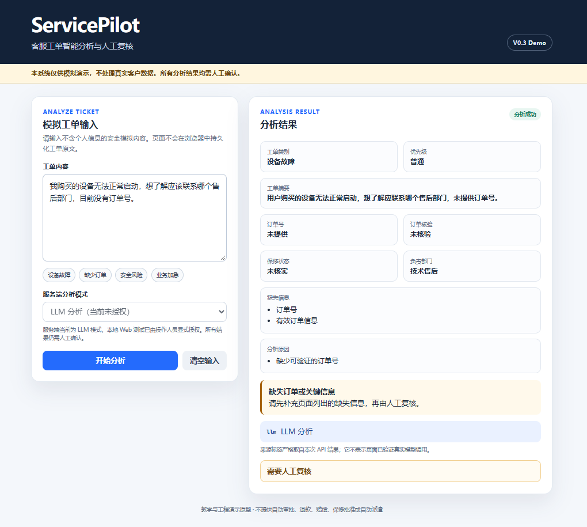

# ServicePilot — AI Customer Support Ticket Agent

基于 FastAPI、可选 DeepSeek LLM 与 Python 业务规则的客服工单智能分析与人工复核演示系统。

ServicePilot 将非结构化售后描述转换为可复核的工单分析结果，展示类别、摘要、订单核验、保修状态、优先级、负责部门、缺失信息、风险原因和分析来源。它面向工程教学、方案演示与 Portfolio 展示，不是生产客服系统。



> 截图来自本地 ServicePilot Web 演示。截图中的 `llm` 是 API 返回的分析来源标签；项目不以截图证明生产部署、生产准确率或可重复的真实模型结果。

## 为什么做 ServicePilot

客服工单通常包含口语化描述、缺失订单信息、业务加急和潜在安全风险。单纯依赖模型生成容易把未经核验的内容当成业务事实。ServicePilot 采用“LLM 生成受限草稿，Python 规则核验业务事实，最终由人工确认”的设计：

- 让工单信息更容易阅读和分流；
- 明确展示分析来自规则、LLM，还是 LLM 失败后的规则降级；
- 对订单号、保修、风险、优先级和人工复核保持确定性约束；
- 在没有 API Key 时仍可完整运行规则模式和离线测试。

## 核心功能

- FastAPI API 与响应模型校验；
- 单页中文 Web 演示界面，支持桌面和窄屏布局；
- 五类工单分类：设备故障、物流查询、退换货、发票问题和其他；
- 模拟订单核验、保修判断、安全风险与业务加急提示；
- `rules`、`llm`、`llm_fallback_rules` 三种来源标记；
- 服务端生成 UUID4 `X-Request-ID`；
- 只记录白名单元数据的最小安全日志；
- SQLite 教学存储 API；Web 的完整工单保存/查询闭环尚未作为 V0.3 展示功能完成；
- 完全离线的规则、API、Web 契约和 LLM Mock 测试。

## 系统架构

```text
Browser
  │  GET /health, POST /analyze
  ▼
FastAPI API ── Request ID / safe metadata log
  │
  ├─ SP_MODE=rules ───────────────► Python rules
  │
  └─ SP_MODE=llm ─► DeepSeek-compatible API ─► Pydantic draft validation
                                                │
                                                ▼
                    Python order / warranty / priority / risk validation
                                                │
                                                ▼
                                  TicketAnalysis + human review
```

主要代码：

- `src/servicepilot/main.py`：API、模式路由、失败降级、request ID 和安全日志；
- `src/servicepilot/llm.py`：DeepSeek 兼容调用与受限草稿校验；
- `src/servicepilot/engine.py`：分类辅助、订单核验、风险、优先级和部门规则；
- `src/servicepilot/storage.py`：模拟订单读取和本地 SQLite 教学存储；
- `web/index.html`：无外部前端依赖的单页演示。

## 规则与 LLM 的职责边界

| 能力 | LLM | Python 规则 |
|---|---:|---:|
| 类别和摘要草稿 | 可选 | 规则模式直接生成 |
| 订单号原文核对 | 否 | 是 |
| 模拟订单是否存在 | 否 | 是 |
| 保修状态 | 否 | 是 |
| 安全风险与业务加急 | 否 | 是 |
| 优先级、部门、人工复核 | 否 | 是 |

模型不能批准退款、赔偿或保修，也不能绕过人工复核。模型输出必须先通过 Pydantic 校验，再交给共享 Python 规则核验。

## 本地快速启动

环境要求：Python 3.11+ 与 [uv](https://docs.astral.sh/uv/)。

```powershell
uv sync --extra dev
$env:SP_MODE="rules"
$env:SP_LLM_FALLBACK="off"
$env:SP_REAL_LLM_WEB_AUTHORIZED="false"
uv run uvicorn servicepilot.main:app
```

打开：

- Web：`http://127.0.0.1:8000/`
- OpenAPI：`http://127.0.0.1:8000/docs`

规则模式不需要 API Key，不访问模型服务。

## 可选 DeepSeek 配置

复制 `.env.example` 为本地 `.env`，仅在本机填写凭据；`.env` 已被 `.gitignore` 排除。不要把 Key 写入源码、命令历史、截图或提交。

相关变量：

| 变量 | 默认值 | 说明 |
|---|---|---|
| `SP_MODE` | `rules` | `rules` 或 `llm` |
| `SP_REAL_LLM_WEB_AUTHORIZED` | `false` | 只有显式 `true` 才允许 LLM 模式从 Web 提交 |
| `SP_LLM_FALLBACK` | `off` | 可设为 `rules` 启用显式降级 |
| `DEEPSEEK_BASE_URL` | `https://api.deepseek.com` | DeepSeek 兼容 API 根地址 |
| `DEEPSEEK_MODEL` | `deepseek-chat` | 以账号实际可用模型为准 |
| `SP_LLM_TIMEOUT_SECONDS` | `30` | 单次请求超时 |

启用真实模型会把模拟工单文本发送给外部服务并可能产生费用。必须先取得授权，只使用安全模拟数据。自动化测试永远使用 Mock，不调用真实 DeepSeek。

## 自动化测试

```powershell
$env:PYTHON_DOTENV_DISABLED="1"
$env:PYTHONDONTWRITEBYTECODE="1"
$env:SP_MODE="rules"
$env:SP_LLM_FALLBACK="off"
$env:SP_REAL_LLM_WEB_AUTHORIZED="false"
uv run --offline pytest -q -p no:cacheprovider
```

公开候选包不包含内部 V0.2 金标准、原始 LLM 运行包或历史评估报告。测试覆盖规则、API、SQLite 隔离、LLM Mock、失败降级、request ID、安全日志和 Web 静态契约。Mock 通过不代表真实模型可用或准确。

本候选包在独立 `.venv` 中的审计结果为：`51 passed, 1 warning`。warning 来自 FastAPI TestClient 使用的 Starlette/httpx 兼容层弃用提示，不影响本次测试退出码。

## 安全与数据说明

- 公开包只包含人工构造的模拟订单与测试文本；
- 不包含原仓库 Git 历史、`.env`、数据库、缓存、运行日志或内部评估资产；
- 不使用 V0.2 冻结金标准，也不复述其内部准确率；
- 动态文本使用 `textContent` 或安全 DOM API；
- 当前接口没有生产级身份认证、授权、租户隔离或审计能力，不得暴露到公网。

详见 [公开候选安全审计](docs/public_release_audit.md)。

## 已知限制

- 教学和工程演示原型，不是生产系统；
- 没有完整权限控制、合规、监控、限流和高可用设计；
- SQLite 只用于本地教学演示；
- Web 的最近工单列表和完整持久化交互尚未完成；
- LLM 输出具有外部依赖与不可重复性；
- 所有分析均需人工确认，不能描述为自动审批。

## 项目状态与下一步

当前公开候选聚焦 V0.3 的分析体验、来源透明度和安全边界。后续计划包括：

1. 完善模拟工单保存和安全摘要列表；
2. 建设独立、可公开审核的 V0.3 模拟评估集；
3. 增加离线 CI 和发布安全门禁；
4. 在单独授权下开展小规模真实 LLM 验证。

## License

本项目采用 [MIT License](LICENSE)，版权归 Jack Wang 所有。第三方依赖审计见 [Third-party license audit](docs/third_party_licenses.md)。
